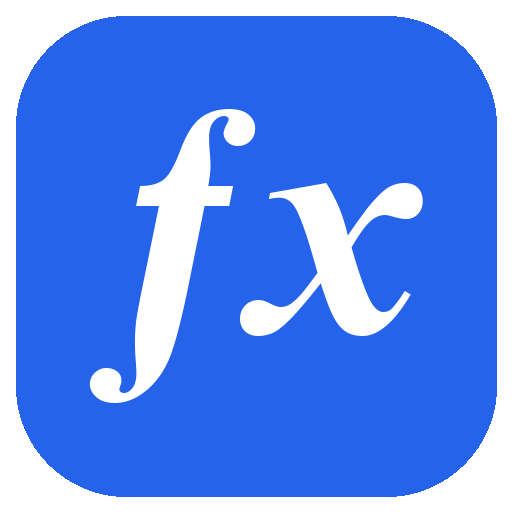
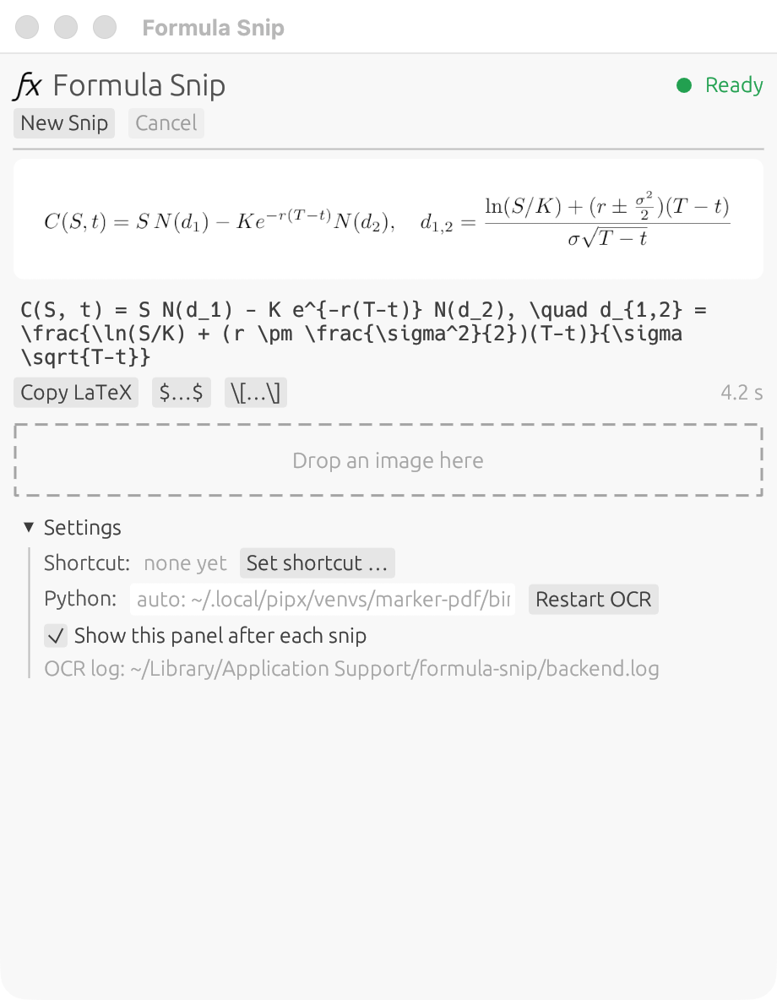
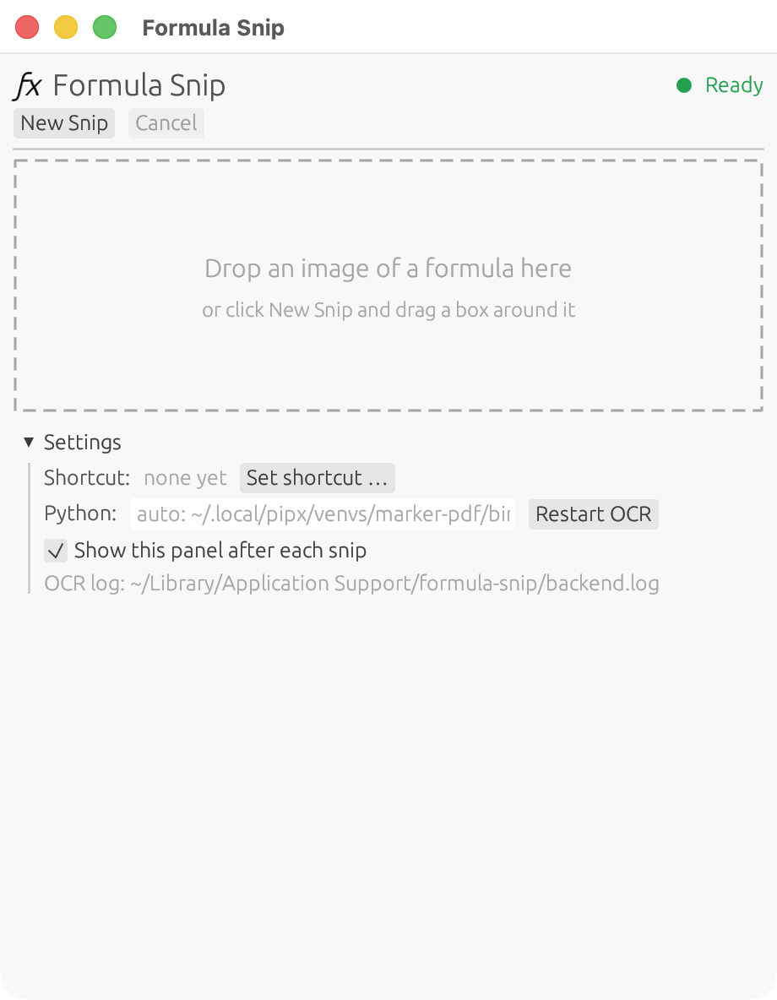
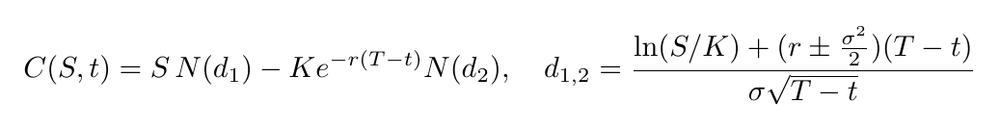
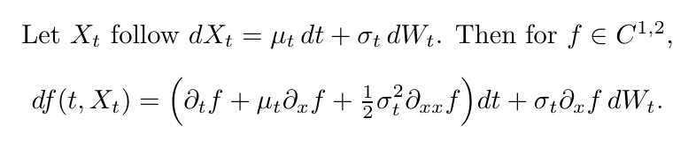
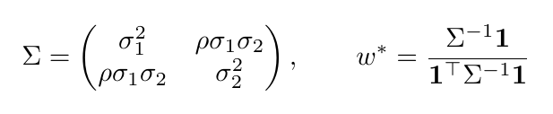
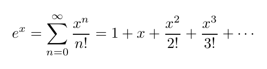
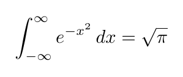

<p align="center"></p>

<h1 align="center">Formula Snip</h1>

<p align="center">Snip any formula on your screen and get its LaTeX in your clipboard.<br>
Runs fully offline on macOS, Windows and Linux, so it works as a local alternative to Mathpix Snip.</p>

<p align="center"></p>

## Features

- **Snip → LaTeX → clipboard.** Press your shortcut, drag a box around a formula, and the LaTeX is copied about 1–2 s later.
- **Menu-bar / tray app.** The ƒx icon opens a small panel with the original image, the LaTeX, copy buttons (`LaTeX`, `$…$`, `\[…\]`) and **Cancel**. No history is kept.
- **Drag & drop.** Drop an image onto the panel to convert it.
- **Your own shortcut.** Nothing is preset. Pick any combination in *Settings*.
- **Private.** OCR runs locally with the open-source [marker](https://github.com/datalab-to/marker) / surya model. Nothing leaves your computer.
- **Text and math.** A single formula gives bare LaTeX. A paragraph gives text with `$inline$` and `\[display\]` math.
- **Small and fast.** One native Rust binary (~5 MB). The model stays loaded in a background helper.
- **Whole papers too.** The panel's *Paper* tab, or `formula-snip convert paper.pdf --out DIR`, turns a PDF into Markdown with `$…$` math and tables. It also writes a registry of every formula and symbol and a generated `formulas.py`. See [Papers](#papers).

## Install

```bash
git clone https://github.com/julian-hilg/formula-snip.git
cd formula-snip
./install.sh          # macOS / Linux
# .\install.ps1       # Windows (PowerShell)
```

The installer sets up everything that's missing (Rust, pipx, `marker-pdf`, `llama.cpp`), builds the app, installs it and runs a test snip. See **[INSTALL.md](INSTALL.md)** for details, manual steps and a prompt you can give a coding agent.

## First start

1. Click the **ƒx** icon in the menu bar (macOS) or system tray (Windows/Linux). The panel opens on first launch.
2. Under **Settings → Shortcut**, click **Set shortcut …** and press the combination you want, e.g. `Ctrl+Alt+M`.
3. Press the shortcut and drag a box around a formula. Esc cancels the selection, and **Cancel** stops a running recognition.

On macOS the first snip asks for **Screen Recording** permission. Allow it, then quit and reopen Formula Snip. It's needed because the app screenshots the region you select (every snipping tool needs it), and newer macOS versions ask again about once a month. Nothing is recorded or uploaded.

If the ƒx icon isn't visible, open Formula Snip again (Spotlight, Launchpad or the Start menu) and the panel appears.

<p align="center"></p>

## Examples

Each image in [`examples/`](examples) and the app's actual, unedited output:

**Black–Scholes**



```latex
C(S, t) = S N(d_1) - K e^{-r(T-t)} N(d_2), \quad d_{1,2} = \frac{\ln(S/K) + (r \pm \frac{\sigma^2}{2})(T-t)}{\sigma \sqrt{T-t}}
```

**Itô's lemma (text + math)**



```latex
Let $X_t$ follow $dX_t = \mu_t dt + \sigma_t dW_t$. Then for $f \in C^{1,2}$,

\[
df(t, X_t) = \left( \partial_t f + \mu_t \partial_x f + \frac{1}{2} \sigma_t^2 \partial_{xx} f \right) dt + \sigma_t \partial_x f dW_t.
\]
```

**Matrix**



```latex
\Sigma = \begin{pmatrix} \sigma_1^2 & \rho\sigma_1\sigma_2 \\ \rho\sigma_1\sigma_2 & \sigma_2^2 \end{pmatrix}, \quad w^* = \frac{\Sigma^{-1} \mathbf{1}}{\mathbf{1}^\top \Sigma^{-1} \mathbf{1}}
```

**Taylor series**



```latex
e^x = \sum_{n=0}^{\infty} \frac{x^n}{n!} = 1 + x + \frac{x^2}{2!} + \frac{x^3}{3!} + \cdots
```

**Gaussian integral**



```latex
\int_{-\infty}^{\infty} e^{-x^2} dx = \sqrt{\pi}
```

## Papers

```bash
formula-snip convert paper.pdf --out paper/            # whole PDF
formula-snip convert paper.pdf --out paper/ --pages 1-12 --json
formula-snip formulas notes.md --out notes/            # registry only, for any Markdown
```

In the panel, open the **Paper** tab, then drop a PDF or click *Choose PDF …*. A page range is optional. Click *Convert*.
- The result goes into a folder named after the PDF, in *Downloads*. *Change …* picks another folder, and the choice is saved as `papers_dir` in `config.json`.
- The panel takes up to 100 pages per PDF. Pages are converted in batches of 10 with a progress bar.
- *Cancel* keeps the finished batches, so converting again continues where it stopped.
- The command line has no page limit.

`convert` runs marker's document pipeline locally (layout, tables, equations) and writes:

| File | Contents |
|---|---|
| `paper.md` | Markdown with `$inline$` and `$$display$$` math, equation numbers as `\tag{N}`, Markdown tables, `<!-- page N -->` markers |
| `images/` | the figures |
| `formulas.json` | every formula: LaTeX, display/inline, page, section, equation number, the sentence around it |
| `variables.json` | every symbol (`\sigma`, `r_f`, `\beta_i` …): where it first appears, which formulas use it, and its definition when the text says "where $r$ denotes …" or "let $S_t$ be …" |
| `formulas.py` | one Python function per display formula sympy can parse. The rest are listed in `UNPARSED` with the reason. |
| `meta.json` | source sha256, pages, marker version, timings, counts |

There is no AI anywhere in the formula pipeline. The registry comes from fixed rules, the
same input always gives the same output, and notation that could be misread is listed with
a reason instead of being guessed. Results are cached by the PDF's sha256, so converting the
same file again takes about a second (`--force` converts it again).

[`examples/papers/`](examples/papers) has three converted papers. The output format and the
`--json` progress events are specified in **[docs/convert.md](docs/convert.md)**.

## How it works

```
 shortcut ─► formula-snip (Rust: egui panel, tray icon, global shortcut)
                │
                ├─► OS region-capture tool ─► PNG
                │     macOS screencapture · Windows Snipping overlay · Linux gnome-screenshot / spectacle / grim+slurp / maim / flameshot
                │
                └─► backend/ocr_server.py ─► marker / surya model (local)
                      started once, model kept in memory; JSON lines over stdin/stdout
                         │
   clipboard + panel ◄── LaTeX
```

The OCR model only exists as a Python package, so the Rust app starts one small Python helper (embedded in the binary) and keeps it running. Everything else is native.

## Configuration

Settings are changed in the panel and saved to `config.json`:

| OS | Location |
|---|---|
| macOS | `~/Library/Application Support/formula-snip/config.json` |
| Linux | `~/.config/formula-snip/config.json` |
| Windows | `%APPDATA%\formula-snip\config.json` |

```json
{
  "hotkey": "Ctrl+Alt+KeyM",
  "python": "",
  "show_panel_after_snip": true,
  "papers_dir": ""
}
```

- `hotkey` uses physical key names (`KeyM`, `Digit1`, `F5`, `Semicolon` …), so it doesn't depend on keyboard layout. It's empty until you set one.
- `python` is the interpreter that has `marker-pdf` installed. Leave it empty to auto-detect the pipx install.
- `papers_dir` is where the Paper tab saves conversions. Leave it empty for the Downloads folder.

## Command line

```bash
formula-snip                      # tray app
formula-snip --show               # open the panel on start
formula-snip a.png b.png          # start and recognise these images
formula-snip paper.pdf            # start with the PDF in the Paper tab
formula-snip --image a.png        # print LaTeX and exit (no GUI)
formula-snip convert a.pdf --out DIR [--pages 1-12] [--mode ocr|fast|balanced] [--batch-pages 10] [--max-pages N] [--force] [--json]
formula-snip formulas a.md [--out DIR] [--json]
```

## Build from source

```bash
cargo build --release             # target/release/formula-snip
cargo test
python3 -m unittest discover -s backend/tests   # registry tests (conversion test needs marker's Python)
scripts/bundle-macos.sh           # macOS: target/FormulaSnip.app
```

Linux needs `libgtk-3-dev libxdo-dev libayatana-appindicator3-dev`. The global shortcut works on X11; on Wayland, use the tray menu or bind `formula-snip` in your desktop's shortcut settings.

## Troubleshooting

- **The shortcut does nothing.** Another app may own that combination (Settings shows an error). Pick a different one.
- **The snip only shows wallpaper (macOS).** Allow Screen Recording under System Settings → Privacy & Security, then reopen the app.
- **"OCR error".** Check the log (path shown in Settings), then click *Restart OCR*.
- **"llama-server binary not found".** Install llama.cpp (`brew install llama.cpp`, or `winget install ggml.llamacpp` on Windows) and click *Restart OCR*.
- **No ƒx icon on a MacBook with a notch.** A full menu bar hides extra icons behind the notch. Open Formula Snip again (Spotlight/Launchpad) to show the panel, or free up menu-bar space.

## License

[MIT](LICENSE). OCR is done by [marker](https://github.com/datalab-to/marker) / [surya](https://github.com/datalab-to/surya), which have their own licenses (including terms for model weights).
