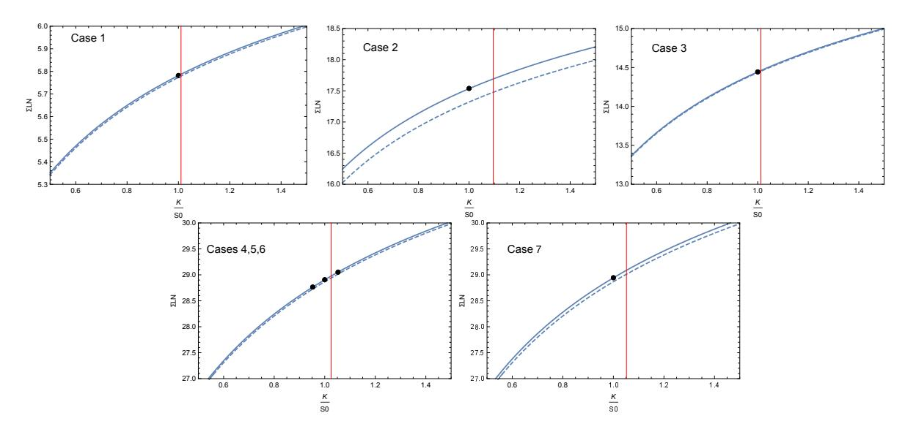

<!-- page 1 -->

## **SUBLEADING CORRECTION TO THE ASIAN OPTIONS VOLATILITY IN THE BLACK-SCHOLES MODEL**

DAN PIRJOL**ABSTRACT.** The short maturity limit  $T \rightarrow 0$  for the implied volatility of an Asian option in the Black-Scholes model is determined by the large deviations property for the time-average of the geometric Brownian motion. In this note we derive the subleading  $O(T)$  correction to this implied volatility, using an asymptotic expansion for the Hartman-Watson distribution. The result is used to compute subleading corrections to Asian options prices in a small maturity expansion, sharpening the leading order result obtained using large deviations theory. We demonstrate good numerical agreement with precise benchmarks for Asian options pricing in the Black-Scholes model.

## 1. INTRODUCTION

$$A_T := \frac{1}{T} \int_0^T S_t dt. \quad A_T := \frac{1}{T} \int_0^T S_t dt. \tag{1}$$

Asian options are derivatives with payoff linked to the time average of the asset price

We are interested in pricing Asian options under the Black-Scholes model where the asset price follows a geometric Brownian motion

$$\frac{dS_t}{S_t} = (r - q)dt + \sigma dW_t, \tag{2}$$

with initial condition  $S_0 > 0$ . Asian options pricing under the Black-Scholes model has been widely studied, using and a large variety of approaches, both numerical and analytical. See [8] for a survey of methods. Restricting to analytical approaches we mention here the Geman-Yor approach [9, 5], the Laguerre polynomial expansion method [3], the PDE expansion method [22, 7], and the spectral method [12]. We mention also the large- and small-strike asymptotics of Asian options in the Black-Scholes model obtained in [11] and [25].

The short maturity asymptotics of Asian option prices has been studied using probabilistic methods from Large Deviations theory [2, 16, 19], assuming that  $S_t$  follows a one-dimensional diffusion

$$dS_t = \sigma(S_t)S_t dW_t + (r - q)S_t dt, \tag{3}$$

under suitable technical conditions on the volatility function  $\sigma(\cdot)$ . These results include as a limiting case the Black-Scholes model corresponding to  $\sigma(x) = \sigma$ . The short maturity asymptotics of Asian options under stochastic volatility models has been studied recently using Malliavin calculus methods in [1].

The leading short maturity asymptotics of the out-of-the-money Asian option prices is given in Theorem 2 in [16]. We quote the result applied to the Black-Scholes model. For simplicity of notation we take  $q = 0$  in the following.

*Key words and phrases.* Asymptotic expansions, Asian options, time integral of the geometric Brownian motion.

*Key words and phrases.* Asymptotic expansions, Asian options, time integral of the geometric Brownian motion.

*Date:* 5 July 2024.

<!-- page 2 -->

**Theorem 1.** *Assume that the asset price follows the Black-Scholes model  $S_t = S_0 e^{\sigma W_t + (r - \frac{1}{2} \sigma^2) t}$ .*
(i) for out-of-the-money call Asian options we have

$$\lim_{T \rightarrow 0} T \log C(K, T) = -\frac{1}{\sigma^2} J_{BS}(K/S_0) , K > S_0 . \tag{4}$$

$$\lim_{T \rightarrow 0} T \log P(K, T) = -\frac{1}{\sigma^2} J_{BS}(K/S_0) , K < S_0 . \tag{5}$$

(ii) for out-of-the-money put Asian options we have

The rate function  $J_{BS}(k)$  is given in closed form in Proposition 12 in [16]

$$J_{BS}(k) = \begin{cases} \frac{1}{2}\beta^2 - \beta \tanh \frac{\beta}{2} & , k \geq 1 \\ 2\xi(\tan \xi - \xi) & , 0 < k \leq 1 \end{cases} \tag{6}$$

where  $\beta$  is the solution of the equation  $\frac{\sinh \beta}{\beta} = k$  and  $\xi$  is the solution in  $[0, \frac{\pi}{2}]$  of the equation  $\frac{\sin 2\xi}{2\xi} = k$ .

 $z_c$ The analyticity properties of the function  $J_{BS}(z)$  in the complex  $z$  plane were studied in [13], see Sec. 4.1. This function has no singularities along the real positive axis, and the closest singularity to  $z = 1$  is a pole at  $z = 0$ . For practical computations it is convenient to use the Taylor expansion of the rate function in powers of  $\log k$ . The first few terms of this expansion are

$$J_{BS}(k) = \frac{3}{2} \log^2 k - \frac{3}{10} \log^3 k + \frac{109}{1,400} \log^4 k + O(\log^5 k). \tag{7}$$

The radius of convergence of this series is determined by the position of the singularities in the complex plane of the function  $z \mapsto J_{BS}(e^z)$  and is  $|\log k| < 3.49295$ , see Proposition 4.1(ii) in [13]. Outside of this region the exact result (6) must be used.

An Asian option with maturity  $T$  and strike  $K$  can be priced as an European option on a Black-Scholes asset, with the same maturity and strike, with an implied volatility  $\Sigma_{\text{LN}}(K, T)$  chosen such that

$$C(K, T) = C_{BS}(K, T; A_{\text{fwd}}, \Sigma_{\text{LN}}(K, T)) \tag{8}$$

where  $C(K, T)$  is the Asian option price, and the forward price  $A_{\text{fwd}}$  is given by

$$A_{\text{fwd}} := \frac{1}{T} \int_0^T \mathbb{E}[S_t] dt = S_0 \frac{e^{(r-q)T} - 1}{(r - q)T} . \tag{9}$$

We call the volatility  $\Sigma_{\text{LN}}(K, T)$  the *equivalent log-normal volatility* of the Asian option, following Sec. 4.3 of [17]. The representation (8) is also useful for computing Asian option sensitivities [18].

The short-maturity asymptotics for the Asian option prices of Proposition 1 is equivalent with a short-maturity asymptotics for the equivalent log-normal volatility

$$\lim_{T \rightarrow 0} \Sigma_{\text{LN}}^2(K, T) = \sigma^2 \frac{\log^2(K/S_0)}{2J_{\text{BS}}(K/S_0)} =: \Sigma_0^2(K/S_0). \tag{10}$$

$$\Sigma_0^2(k) = \sigma^2 \frac{\log^2 k}{2\text{JB}_S(k)} = \frac{1}{3} \sigma^2 \left( 1 + \frac{1}{5} \log k - \frac{1}{84} \log^2 k - \frac{17}{10,500} \log^3 k + O(\log^4 k) \right) \tag{11}$$

Using the expansion (7) we get

where  $k = K/S_0$  and  $J_{BS}(k)$  is the rate function appearing in the statement of Proposition 1. See also Proposition 18 in [16]. A similar asymptotic result was obtained in [16] in the more

<!-- page 3 -->

general setting of the local volatility model, and in [20] for a class of jump-diffusion models with local volatility.

While our study of the equivalent log-normal volatility  $\Sigma_{LN}(K, T)$  is limited to a short maturity expansion, we note an exact prediction which can be extracted from the results of Ref. [25]. Proposition 1 in this paper implies the extreme strikes asymptotics  $\lim_{K\downarrow \infty} \Sigma_{LN}(K, T) = \sigma$ , for any  $T > 0$ .

The equivalent log-normal variance can be expanded in a short maturity expansion as

$$\Sigma_{LN}^2(K, T) = \Sigma_0^2(e^x) + 2\Sigma_0(e^x)\Sigma_1(K, T)T + O(T^2). \tag{12}$$

When including the higher order corrections in  $T$ , it will be seen to be convenient to work with the log-moneyness parameter  $x = \log(K/A_{\text{fwd}})$ . This is expanded as  $x = \log k + O(rT)$ , such that at leading order in  $T$  the log-moneyness and log-strike are equivalent. When working at higher orders in  $T$  it is important to keep track of the higher order terms in this relation.

In this paper, we compute the  $O(T)$  term in the expansion (12). This correction can be expanded in powers of log-moneyness as

$$\frac{1}{\sigma^2} 2\Sigma_0(e^x) \Sigma_1(K, T) T = (\sigma^2 T)(s_0 + s_1 x + O(x^2)) + (rT)(r_0 + r_1 x + O(x^2)). \tag{13}$$

We give explicit results for the first two terms in this expansion  $r_{0,1}, s_{0,1}$ . The higher order terms in the  $x$ -expansion can be evaluated using the same approach.

We summarize the expansion of the Asian implied volatility including the  $O(T)$  term in the following result. This is the main result of this paper.

**Proposition 2.** *Assume that the asset price follows the Black-Scholes model  $dS_t = \sigma S_t dW_t + r S_t dt$ . The equivalent log-normal variance of an Asian option with strike  $K$  and maturity  $T$  is*

$$\Sigma_{\text{LN}}^2(K, T) = \sigma^2 \left\{ \underbrace{\frac{x^2}{2J_{\text{BS}}(e^x)}}_{O(1)} - \underbrace{\frac{61}{9,450}(\sigma^2 T) + \frac{1}{12}(rT)}_{O(T)} + \underbrace{\left[ -\frac{34}{23,625}(\sigma^2 T) \right] x + O(Tx^2) + O(T^2)}_{O(Tx)} \right\}. \tag{14}$$

where  $x = \log(K/A_{\text{fwd}})$  is the option log-moneyness.

$$\Sigma_{\text{LN}}^2(K = A_{\text{fwd}}, T) = \sigma^2 \left( \frac{1}{3} - \frac{61}{9,450}(\sigma^2 T) + \frac{1}{12}(rT) + O(T^2) \right). \tag{15}$$

In particular, for an at-the-money Asian option with strike  $K = A_{\text{fwd}}$  we have

**1.1. Standardization.** It is convenient to standardize the pricing problem by reducing it to the study of the distributional properties of the quantity

$$A_t^{(\mu)} = \int_0^t e^{2(B_s + \mu s)} ds, \tag{16}$$

where  $B_t$  is a standard Brownian motion. Using the rescaling property of the Brownian motion  $B_{\lambda t} = \sqrt{\lambda}B_t$ , the time-average of the geometric Brownian motion in (1) can be expressed in terms of  $A_t^{(\mu)}$  as [9]

$$A_T = \frac{4S_0}{\sigma^2 T} A_{\frac{1}{4}\sigma^2 T}^{(\frac{2r}{\sigma^2} - 1)} = S_0 \frac{1}{\tau} A_{\tau}^{(\mu)}, \quad \tau = \frac{1}{4} \sigma^2 T, \quad \mu = \frac{2r}{\sigma^2} - 1. \tag{17}$$

<!-- page 4 -->

The prices of fixed strike Asian options with averaging over the period  $[0, T]$  and strike  $K$  can be expressed in terms of the standardized average  $\frac{1}{\tau} A_T^{(\mu)}$  as [9]

$$C(K, T) = e^{-rT} \mathbb{E} \left[ \left( \frac{1}{T} A_T - K \right)^+ \right] = S_0 e^{-rT} c(k, \tau) \tag{18}$$

$$P(K, T) = e^{-rT} \mathbb{E} \left[ \left( K - \frac{1}{T} A_T \right)^+ \right] = S_0 e^{-rT} p(k, \tau). \tag{19}$$

$$c(k, \tau) := \mathbb{E} \left[ \left( \frac{1}{\tau} A_\tau^{(\mu)} - k \right)^+ \right], \quad p(k, \tau) := \mathbb{E} \left[ \left( K - \frac{1}{\tau} A_\tau^{(\mu)} \right)^+ \right]. \tag{20}$$

with  $k = K/S_0$  and

The normalized Asian options  $c(k, \tau), p(k, \tau)$  correspond to volatility  $\sigma = 2$  and drift  $r = \mu + 1$ , with  $S_0 = 1$ . The equivalent log-normal volatility for the normalized options  $\sigma_{LN}(k, \tau)$  is defined as

$$c(k, \tau) = C_{BS}(k, \tau; a_{\text{fwd}}^{(\mu)}, \sigma_{\text{LN}}(k, \tau)), \quad a_{\text{fwd}}^{(\mu)} := \mathbb{E} \left[ \frac{1}{\tau} A_{\tau}^{(\mu)} \right] = \frac{e^{2(\mu+1)\tau} - 1}{2(\mu+1)\tau}. \tag{21}$$

This is rescaled to the general  $S_0, r, \sigma$  BS model as

$$\Sigma_{LN}^2(K, T; S_0, \sigma) = \frac{1}{4} \sigma^2 \sigma_{LN}^2 \left( \frac{K}{S_0} , \frac{1}{4} \sigma^2 T \right). \tag{22}$$

**1.2. Outline.** The paper is structured as follows. The starting point is the asymptotic expansion of the density of the time average of the gBM  $\frac{1}{t}A_t^{(\mu)}$  given in Proposition 6 in [21], obtained from a small time expansion of the Hartman-Watson distribution. We collect the relevant properties of this expansion in Section 2.

The proof of the main result, Proposition 2, is given in Section 3 and is divided into three parts, organized as separate sections. In Section 3.1 we compute the subleading correction to the price of Asian options in the BS model in a small maturity expansion. This is used in Sections 3.2 and 3.3 to obtain the  $O(T)$  correction to the equivalent log-normal implied volatility of an Asian option by an application of the Gao-Lee transfer result [10]. The result can be used as the basis of a simple numerical pricing approximation for Asian options in the Black-Scholes model. In Section 4 we present numerical tests on benchmark cases in the literature, showing that adding the subleading correction improves the agreement of the asymptotic expansion with the benchmark evaluations.

The starting point for our analysis is a result obtained in [21] for the leading asymptotics of the density of  $\frac{1}{t}A_t^{(\mu)}$  as  $t \rightarrow 0$ . This was obtained by applying Laplace asymptotic methods to a one-dimensional integral giving this density (due to Yor [24]), combined with an asymptotic expansion for the Hartman-Watson distribution  $\theta(r, t)$  as  $t \rightarrow 0$ .

For completeness, we summarize the main results of [21]. Denote the density of the normalized average of the geometric Brownian motion (gBM)

$$\mathbb{P}\left(\frac{1}{\tau} A_\tau^{(\mu)} \in da\right) = f(a, \tau) \frac{da}{a}. \tag{23}$$

<!-- page 5 -->

The density is expressed as [24]

$$f(a, \tau) = e^{-\frac{1}{2}\mu^2\tau} a^{\mu-1} \int_0^\infty \rho^\mu e^{-\frac{1+a^2\rho^2}{2a\tau}} \theta(\rho/\tau, \tau) \frac{d\rho}{\rho} \tag{24}$$

$$\theta(r, t) = \frac{r}{\sqrt{2\pi^3 t}} e^{\frac{\pi^2}{2t}} \int_0^\infty e^{-\frac{\xi^2}{2t}} e^{-r \cosh \xi} \sinh \xi \sin \frac{\pi \xi}{t} d\xi \tag{25}$$

The Hartman-Watson function is defined by the integral

$$\theta(\rho/t, t) = \frac{1}{2\pi t} e^{-\frac{1}{t}[F(\rho) - \frac{\pi^2}{2}]} G(\rho) (1 + \vartheta(\rho, t)) \tag{26}$$

Proposition 1 of [21] gives an expansion for this function as  $t \rightarrow 0$  at fixed  $\rho = rt$

where the functions  $F(\rho), G(\rho)$  are known in closed form, and the error term is bounded as  $|\vartheta(\rho, t)| \leq \frac{1}{70}t$ .

The density of the time integral of the gBM  $f(a, \tau)$  can be approximated with the (properly normalized) leading term of this expansion as  $f(a, \tau) = f_0(a, \tau)(1 + \varepsilon(a, \tau))$  with

$$f_0(a, \tau) := \frac{1}{n(\tau)} f_{\text{HW}}(a, \tau) \tag{27}$$

$$f_{HW}(a, \tau) := \frac{1}{2\pi\tau} e^{-\frac{1}{2}\mu^2\tau} a^{\mu-1} \int_0^\infty \rho^\mu G(\rho) e^{-\frac{1}{\tau}H(\rho, a)} \frac{d\rho}{\rho}. \tag{28}$$

where

We denoted here

$$H(\rho) = \frac{1 + a^2 \rho^2}{2a} - \frac{\pi^2}{2} + F(\rho) \tag{29}$$

$$n(\tau) = \int_0^\infty f_{HW}(a, \tau) \frac{da}{a} \tag{30}$$

is a normalization factor which ensures that  $f_0(a, \tau)$  is normalized as  $\int_0^\infty f_0(a, \tau) \frac{da}{a} = 1$ . The error of the approximation (27) is bounded by the following result.

The error of the approximation (27) is bounded by the following result.

$$f_0(a, \tau) \frac{-\frac{1}{35}\tau}{1 + \frac{1}{70}\tau} \leq f(a, \tau) - f_0(a, \tau) \leq f_0(a, \tau) \frac{\frac{1}{35}\tau}{1 - \frac{1}{70}\tau}. \tag{31}$$

**Proposition 3.** *The error of the approximation (27) is bounded as*

*Proof.* Using (24) we have

$$\begin{aligned} (32) |f(a, \tau) - f_{HW}(a, \tau)| &\leq e^{-\frac{1}{2}\mu^2\tau} a^{\mu-1} \int_0^\infty \rho^\mu e^{-\frac{1+a^2\rho^2}{2a\tau}} |\theta(\rho/\tau, \tau) - \frac{1}{2\pi\tau} e^{-\frac{1}{\tau}[F(\rho) - \frac{\pi^2}{2}]} G(\rho)| \frac{d\rho}{\rho} \\ &\leq \frac{1}{2\pi\tau} e^{-\frac{1}{2}\mu^2\tau} a^{\mu-1} \int_0^\infty \rho^\mu G(\rho) e^{-\frac{1}{\tau}H(\rho, a)} |\vartheta(\rho, \tau)| \frac{d\rho}{\rho} \leq \frac{1}{70} \tau f_{HW}(a, \tau) \end{aligned}$$

In the last step we used the error bound  $|\vartheta(\rho, \tau)| \leq \frac{1}{70}\tau$ .

In a similar way we have

$$|1 - n(\tau)| = \left| \int_0^\infty (f(a, \tau) - f_{HW}(a, \tau)) \frac{da}{a} \right| \leq \int_0^\infty |f(a, \tau) - f_{HW}(a, \tau)| \frac{da}{a} \\ \leq \frac{1}{70} \tau \int_0^\infty f_{HW}(a, \tau) \frac{da}{a} = \frac{1}{70} \tau n(\tau) , \tag{33}$$

<!-- page 6 -->

From these two inequalities we get

$$\frac{1}{1 + \frac{1}{70}\tau} f(a, \tau) \leq f_{HW}(a, \tau) \leq \frac{1}{1 - \frac{1}{70}\tau} f(a, \tau) \tag{34}$$

and

$$\frac{1}{1 + \frac{1}{70}\tau} \leq n(\tau) \leq \frac{1}{1 - \frac{1}{70}\tau} \tag{35}$$

$$\frac{1 - \frac{1}{70}\tau}{1 + \frac{1}{70}\tau} f(a, \tau) \leq f_0(a, \tau) \leq \frac{1 + \frac{1}{70}\tau}{1 - \frac{1}{70}\tau} f(a, \tau). \tag{36}$$

Taking their ratio gives

These inequalities can be inverted to give bounds for  $f(a, \tau)$  in terms of  $f_0(a, \tau)$ , which can be expressed as the error bounds (31).

In this paper we are interested in the small- $\tau$  expansion of the integral (28). The application of Laplace asymptotic methods to this integral gives the more explicit result.

**Proposition 4.** *[Proposition 6 in [21]] We have the  $\tau \rightarrow 0$  asymptotics*

$$f_{HW}(a, \tau) = \frac{1}{\sqrt{2\pi\tau}} g(a, \mu) e^{-\frac{1}{\tau} J(a)} (1 + O(\tau)) \tag{37}$$

$$g(a, \mu) := (a\rho_*)^\mu G(\rho_*) \frac{1}{\sqrt{H''(\rho_*)}} \frac{1}{\rho_*}. \tag{38}$$

*where*

We denote here  $J(a) \equiv \inf_{\rho \geq 0} H(\rho) = H(\rho_*)$  and  $\rho_* = \operatorname{argmin} H(\rho)$ . From (29) it follows that the minimizer  $\rho_*$  depends only on a but not on  $\mu$ .

The leading asymptotics of the function  $f_{HW}(a, \tau)$  in (37) depends on two functions  $J(a)$  and  $g(a, \mu)$ . The properties of the function  $J(a)$  were studied in Sec. 4.1 of [21] where it was shown that it is simply related to the rate function  $J_{BS}(k)$  appearing in the short-maturity asymptotics of Asian options, as

$$J(a) = \frac{1}{4} J_{BS}(a). \tag{39}$$

The following expansion of  $g(a, \mu)$  was obtained in Proposition 10 of [21]. The coefficient  $c_3$  quoted below is new.

**Proposition 5.** *The function  $g(a, \mu)$  has the expansion*

$$g(a, \mu) = e^{\mu \log a + (\mu-1) \log \rho_*(a)} G(\rho_*) \frac{1}{\sqrt{H''(\rho_*)}} \\ = \frac{\sqrt{3}}{2} e^{c_1 \log a + c_2 \log^2 a + c_3 \log^3 a + O(\log^4 a)} . \tag{40}$$

<!-- page 7 -->

*The first few coefficients  $c_i$  are*

$$c_2 = -\frac{3}{80}(\mu + 1) + \frac{57}{1,400} \tag{42}$$

$$c_1 = \frac{3}{4}(\mu + 1) - \frac{4}{5} \tag{41}$$

$$c_3 = \frac{1}{350}(\mu + 1) - \frac{1}{875} \cdot \tag{43}$$

### 3. SUBLEADING CORRECTIONS TO THE ASIAN IMPLIED VOLATILITY

The equivalent log-normal volatility  $\Sigma_{\text{LN}}(K, T)$  of an Asian option in the Black-Scholes model can be expanded in powers of maturity as

$$\Sigma_{\text{LN}}(K, T) = \Sigma_0(K/S_0) + T\Sigma_1(K, S_0) + O(T^2). \tag{44}$$

The leading term in this expansion is determined from the short-maturity asymptotics of the Asian option prices [16]

$$\Sigma_0^2(k) = \sigma^2 \frac{\log^2 k}{2J_{\text{BS}}(k)} = \frac{1}{3} \sigma^2 \left( 1 + \frac{1}{5} \log k - \frac{1}{84} \log^2 k - \frac{17}{10,500} \log^3 k + O(\log^4 k) \right). \tag{45}$$

We compute here the subleading term of  $O(T)$  to the equivalent log-normal volatility. The proof proceeds in three steps. In the first step (Sec. 3.1) we compute the short maturity asymptotics for the reduced Asian option prices. In the second step (Sec. 3.2) we determine the equivalent log-normal volatility in the driftless case  $r = 0$ , and in the third step (Sec. 3.3) a non-zero interest rate is added.

See Proposition 18 in [16], where the equivalent log-normal volatility is denoted  $\Sigma_{\text{LN}}(K, S_0)$ .

**3.1. Short maturity asymptotics for Asian option prices.** In this section we use the asymptotic distribution of the time average  $\frac{1}{t}A_t^{(\mu)}$  in Proposition 4 to compute the price of OTM Asian options in the Black-Scholes model.

**Proposition 6.** *The leading asymptotics for the OTM Asian options with reduced strike  $k = K/S_0$  and maturity  $\tau$  is*

$$c(k, \tau) = \sqrt{\frac{\tau^3}{2\pi}} \frac{g(k, \mu)}{k[J'(k)]^2} e^{-\frac{1}{\tau} J(k)} (1 + O(\tau)), \quad k \geq 1 \tag{46}$$

$$p(k, \tau) = \sqrt{\frac{\tau^3}{2\pi}} \frac{g(k, \mu)}{k[J'(k)]^2} e^{-\frac{1}{\tau} J(k)} (1 + O(\tau)), \quad k \leq 1. \tag{47}$$

*Proof.* The reduced Asian option price is expressed as an integral over the exact distribution of the time-integral of the gBM  $f(a, \tau)$ , defined in (23)

$$c(k, \tau) = \int_0^\infty (a - k)^+ f(a, \tau) \frac{da}{a} . \tag{48}$$

i) replace  $f(a, \tau)$  with its  $\tau \rightarrow 0$  leading order approximation  $f_0(a, \tau)$  defined in (27). Define the corresponding approximation for the option prices

We derive an approximation for  $c(k, \tau)$  by performing two successive approximations:

$$c_0(k, \tau) := \int_0^\infty (a - k)^+ f_0(a, \tau) \frac{da}{a}, \quad p_0(k, \tau) := \int_0^\infty (k - a)^+ f_0(a, \tau) \frac{da}{a}. \tag{49}$$

<!-- page 8 -->

The error of this approximation is bounded using the error bound (31) as

$$-\frac{1}{35}\tau \frac{1}{1 + \frac{1}{70}\tau} c_0(k, \tau) \leq c(k, \tau) - c_0(k, \tau) \leq \frac{1}{35}\tau \frac{1}{1 - \frac{1}{70}\tau} c_0(k, \tau) \tag{50}$$

$$|c(k, \tau) - c_0(k, \tau)| \leq \frac{1}{35} \tau \frac{1}{1 + \frac{1}{70} \tau} c_0(k, \tau). \tag{51}$$

and analogous for  $p(k, \tau)$ . The approximation error is bounded in absolute value as

The approximation  $c_0(k, \tau)$  is expressed as a double integral with an integrand known in closed form. This can be easily evaluated numerically, and offers a simple approximation for pricing Asian options in the Black-Scholes model, with controlled approximation error. Tests of this approach in Section 5 of [13] demonstrate good agreement with the precise benchmarks of [12].

ii) Next we compute the leading approximation for  $c_0(k, \tau)$  as  $\tau \rightarrow 0$  using standard Laplace asymptotic methods for integrals. The result we use is due to Erdélyi, see Sec. 2.4 in [6], and appears as Theorem 8.1 in Olver [15]. We give a few details of the application of this result to the Asian call price asymptotics, using the notations of Theorem 1.2.1 of Nemes [14], which is reproduced in the Appendix. The theorem applies to our case with the substitutions:

$$\lambda \mapsto 1/\tau, \quad f(x) \mapsto J(a), \quad g(x) \mapsto \frac{1}{\sqrt{2\pi\tau}}(a - k)g(a, \mu) \frac{1}{a} \tag{52}$$

and  $\alpha = 1, \beta = 2$ .

The technical conditions of the theorem are satisfied: i) The function  $J(a)$  is increasing on the integration interval  $[k, \infty)$  with  $k > 1$ . ii)  $J(a), g(a, \mu)$  are continuous functions on  $a \in [k, \infty)$ . iii) The functions  $J(a), g(a, \mu)$  can be expanded around  $k > 1$  as in (88). For  $J_{BS}(x)$  this follows from the analyticity of this function for  $x > 0$ , see Sec. 4.1 in [13]. A similar result holds for  $g(a, \mu)$  and follows from the analyticity of  $F(\rho), G(\rho)$  for real positive  $\rho$  proved in Sec. 4.2 of [13]. The leading coefficients in the expansion (88) are

$$a_0 = J'(k), \quad b_0 = \frac{1}{\sqrt{2\pi\tau}} g(k, \mu) \frac{1}{k}. \tag{53}$$

iv) The integrals (49) converge. See Sec. 5 of [13] for numerical evaluations of  $c_0(k, \tau)$ .

$$c_0^L(k, \tau) := e^{-\frac{1}{\tau} J(k)} \frac{d_0}{(1/\tau)^2} = \sqrt{\frac{\tau^3}{2\pi}} \frac{g(k, \mu)}{k[J'(k)]^2} e^{-\frac{1}{\tau} J(k)} \tag{54}$$

At leading order the Laplace asymptotic expansion (89) gives  $c_0(k, \tau) = c_0^L(k, \tau)(1 + O(\tau))$  with

$$d_0 = \frac{b_0}{a_0^2} = \frac{1}{\sqrt{2\pi\tau}} g(k, \mu) \frac{1}{k(J'(k))^2} . \tag{55}$$

where we used

The correction to the leading order term is of order  $|c_0(k, \tau) - c_0^L(k, \tau)| = c_0^L(k, \tau)(1 + O(\tau))$ .

The combined error of the two approximations is

$$|c(k, \tau) - c_0^L(k, \tau)| \leq |c(k, \tau) - c_0(k, \tau)| + |c_0(k, \tau) - c_0^L(k, \tau)| \\ \leq c_0(k, \tau)(1 + O(\tau)) + c_0^L(k, \tau)(1 + O(\tau)) = c_0^L(k, \tau)(1 + O(\tau)). \tag{56}$$

This reproduces the quoted result (46). The Asian put option result (47) is obtained in a similar way.  $\square$

<!-- page 9 -->

**3.2. The driftless case  $r = 0$ .** We start with the simpler case  $r = 0$ . Recall that in terms of the normalized parameters introduced in Sec. 1.1 this corresponds to  $\mu = -1$ . In the next step (Sec. 3.3) we include the contribution of a non-zero interest rate.

The starting point is the asymptotic result for option prices of Proposition 6. The leading asymptotic result for an OTM Asian call option has the form  $c(k, \tau) = \tau^{3/2} h(k) e^{-\frac{1}{\tau} J(k)}$  with  $h(k) = \frac{1}{\sqrt{2\pi}} \frac{g(k, \mu)}{[J'(k)]^2}$ . Recall  $k = K/S_0$ .

The small- $\tau$  asymptotics of the Asian option can be expressed as an expansion for the log-price  $L = -\log c(k, \tau)$ . Using the notations of Gao and Lee [10], the first terms of this asymptotics are

$$L = -\log c(k, \tau) = \frac{1}{\tau} J(k) - \frac{3}{2} \log \tau + \alpha_0(k) \tag{57}$$

with  $\alpha_0(k) := -\log h(k)$  which is expanded as

$$\alpha_0(k) = -\log\left(\frac{16\sqrt{3}}{18\sqrt{2\pi}} \cdot \frac{k}{\log^2 k}\right) + 2\log\left(1 - \frac{3}{10} \log k + O(\log^2 k)\right) - \sum_{i=1}^{\infty} c_i \log^i k \tag{58}$$

The second term in this expression is the contribution from  $J'(k)$  which is expanded by substituting the series expansion (7) for  $J_{BS}(k)$  and differentiating term by term

$$J'(k) = \frac{1}{4} J'_{\text{BS}}(k) = \frac{3}{4k} \log k \left( 1 - \frac{3}{10} \log k + \frac{109}{1,050} \log^2 k + O(\log^3 k) \right). \tag{59}$$

The third term in (58) contains the contribution of the exponential factor for  $g(k, \mu)$  in Proposition 5, which is determined by the coefficients  $c_i$  appearing in the expansion of the exponent around  $k = 1$ .

By Corollary 7.4 in Gao, Lee [10], the asymptotic implied variance is

$$\sigma_{\text{LN}}^2(k, \tau) = \frac{\log^2 k}{2J(k)} - \frac{\log^2 k}{4J^2(k)} \left( \log k + \log \frac{\log^2 k}{16\pi} + 2\alpha_0(k) - 3 \log J(k) \right) \tau + O(\tau^2) \tag{60}$$

$$B(k) := \log k + \log \frac{\log^2 k}{16\pi} + 2\alpha_0(k) - 3 \log J(k) \\ = b_0 + b_1 \log k + b_{1L} \log \log^2 k + b_2 \log^2 k + O(\log^3 k). \tag{61}$$

The expression in the brackets in the second term of (60) is expanded around  $k = 1$  as

Expanding in  $\log k$  gives the coefficients

$$b_1 = -\left(1 + \frac{3}{5} + 2c_1\right) = -\frac{3}{2}(\mu + 1) \tag{63}$$

$$b_0 = 0 \tag{62}$$

$$\begin{aligned} (61) \quad b_{1L} &= 0 \\ (65) \quad b_2 &= \frac{293}{2,100} - 2c_2 = \frac{61}{1,050} + \frac{3}{40}(\mu + 1). \end{aligned}$$

$$b_{1L} = 0 \tag{64}$$

We keep the terms proportional to  $\mu + 1$ , although they vanish for  $r = 0$ , in order to keep track of their contributions for general  $r$  in Sec. 3.3.

In the third line we used  $c_1 = -\frac{4}{5} + \frac{3}{4}(\mu + 1)$  from (41) to obtain the null result for  $b_{1L}$ . In the last line we used  $c_2 = \frac{57}{1400} - \frac{3}{80}(\mu + 1)$  from (42).

<!-- page 10 -->

Substituting the expansion (61) into (60) we get the expansion in  $\log k$

$$\sigma_{\text{LN}}^2(k, \tau) = \frac{\log^2 k}{2J(k)} + \left\{ -\frac{16b_1}{9 \log k} - \frac{16}{45} (2b_1 + 5b_2) - \frac{8(17b_1 + 420b_2 + 1,050b_3)}{4,725} \log k + O(\log^2 k) \right\} \tau + O(\tau^2). \tag{66}$$

Note the presence of a singular term  $1/\log k$  in the subleading volatility proportional to  $b_1$  since  $b_1 = -\frac{3}{2}(\mu + 1)$  this divergent term vanishes for the driftless gBM case  $\mu = -1$ . After a more careful analysis in Sec. 3.3 it will be seen to cancel also for the gBM with non-zero drift.

Substituting the expressions for  $b_i$  from (63), (65) into (60) gives an explicit result for the ATM implied variance to  $O(\tau)$  for the driftless case  $\mu = -1$

$$\sigma_{\text{LN}}^2(k, \tau)|_{\mu=-1} = \frac{x^2}{2J(e^x)} + \left( -\frac{488}{4,725} + O(x) \right) \tau + O(\tau^2). \tag{67}$$

Rescaling to general  $(\sigma, r, T)$  using (22) gives the first terms in the equivalent log-normal volatility of an Asian option stated in Proposition 2. Keeping only the ATM expression for the  $O(T)$  term this is

$$\Sigma_{\text{LN}}^2\left(\frac{K}{S_0}, T\right)|_{r=0} = \Sigma_0^2\left(\frac{K}{A_{\text{fwd}}}\right) + \sigma^2\left(-\frac{61}{9,450}(\sigma^2 T) + O(x)\right) + O(T^2). \tag{68}$$

**3.3. Including a non-zero interest rate  $r$ .** In the last step of the proof we include the contribution of the rate  $r$  into the log-strike definition. We will show that this ensures the cancellation of the divergent term proportional to  $\mu + 1$  in (66), and adds a new finite term proportional to this factor.

Expanding the log-moneyness of the Asian option to order  $O(\tau)$  we have

$$x = \log \frac{k}{a_{(\mu)}} = \log k - (\mu + 1)\tau + O(\tau^2) \tag{69}$$

where the forward price is the average of  $A_\tau^{(\mu)}$  obtained using  $r = \mu + 1$  in standardized units

$$a_{\text{fwd}}^{(\mu)} := \mathbb{E} \left[ \frac{1}{\tau} A_{\tau}^{(\mu)} \right] = \frac{1}{2(1+\mu)\tau} \left( e^{2(1+\mu)\tau} - 1 \right) \simeq 1 + (\mu+1)\tau + O(\tau^2). \tag{70}$$

*Proof of the general result  $r \neq 0$ .* The small- $\tau$  expansion of  $L = -\log c(k, \tau)$  at fixed  $x$  is obtained by replacing  $k \rightarrow (1 + (\mu + 1)\tau)e^x$  into (57). To  $O(\tau)$  it is sufficient to replace  $\log k \mapsto x + (\mu + 1)\tau$ . Expanding in  $\tau$  we find

$$\begin{aligned} (71) \quad L &= \frac{1}{\tau} J(e^x) + (\mu + 1)e^x J'(e^x) - \frac{3}{2} \log \tau + \alpha_0(e^x) + O(\tau) \\ &= \frac{1}{\tau} J(e^x) + (\mu + 1) \left( \frac{3}{4}x - \frac{9}{40}x^2 + \frac{109}{1,400}x^3 + O(x^4) \right) - \frac{3}{2} \log \tau + \alpha_0(e^x) + O(\tau) \\ &:= \frac{1}{\tau} J(e^x) - \frac{3}{2} \log \tau + \tilde{\alpha}_0(e^x) + O(\tau). \end{aligned}$$

<!-- page 11 -->

In the last step we absorbed the second term in the second line into  $\tilde{\alpha}_0(e^x)$ . The effect of the new term is to shift the coefficients  $b_k$  defined in (61) as

$$b_1 \rightarrow \tilde{b}_1 := b_1 + \frac{3}{2}(\mu + 1) = 0 \tag{72}$$

$$b_2 \rightarrow \tilde{b}_2 := b_2 - \frac{9}{20}(\mu + 1) = \frac{61}{1,050} - \frac{3}{8}(\mu + 1). \tag{73}$$

$$\sigma_{LN}^2(e^x, \tau) = \frac{x^2}{2J(e^x)} + \left\{ -\frac{16\tilde{b}_1}{9x} - \frac{16}{45} (2\tilde{b}_1 + 5\tilde{b}_2) - \frac{8(17\tilde{b}_1 + 420\tilde{b}_2 + 1,050\tilde{b}_3)}{4,725} x + O(x^2) \right\} \tau + O(\tau^2) \tag{74}$$

Substituting  $b_i \rightarrow \tilde{b}_i$  into (66) gives

$$\sigma_{\text{LN}}^2(e^x, \tau) = \frac{x^2}{2J(e^x)} + \left( -\frac{488}{4,725} + \frac{2}{3}(\mu + 1) - \frac{544}{23,625}x + O(x^2) \right) \tau + O(\tau^2). \tag{75}$$

Substituting here the explicit results for  $\tilde{b}_i$  from (72), (73) we get

All singular terms as  $x \rightarrow 0$  cancel out, and the Asian volatility  $\sigma_{\text{LN}}(e^x, \tau)$  is finite and well-defined at the ATM point  $x = 0$ .

Rescaling to arbitrary volatility  $\sigma$  and the actual maturity  $T$  using  $\tau \rightarrow \frac{1}{4}\sigma^2 T, \mu + 1 \rightarrow \frac{2r}{\sigma^2}$ , see (22), gives the final result

$$\Sigma_{\text{LN}}^2(K, T, S_0) = \sigma^2 \left\{ \frac{x^2}{2J_{\text{BS}}(e^x)} - \frac{61}{9,450}(\sigma^2 T) + \frac{1}{12}(rT) - \frac{34}{23,625}(\sigma^2 T)x + O(x^2 T) + O(T^2) \right\}. \tag{76}$$

Numerically the ATM implied variance is  $\frac{1}{3} - 0.00645(\sigma^2 T) + 0.083(rT)$ , such that the  $O(rT)$  term dominates the subleading contribution for most realistic values of the model parameters. The correction linear in log-moneyness is  $-0.00144(\sigma^2 T)x$ .

This concludes the proof of Proposition 2.

**3.4. Consistency check and an improved estimate.** The small maturity limit of the equivalent log-normal volatility of an Asian option in the Black-Scholes model has been obtained in [17] in a modified small maturity limit  $\sigma^2 T \rightarrow 0$  taken at fixed  $\rho = rT$ . This limit takes into account interest rates effects; more precisely it includes corrections of the order  $O((rT)^n)$  to all orders in  $n$ .

The result is given in Proposition 19 of [17] and we denote it as  $\Sigma_{\text{LN},\rho}(K, \rho)$ . As  $\rho \rightarrow 0$ , this reduces to  $\Sigma_0(K/S_0)$  given in (10).

The Asian volatility  $\Sigma_{\text{LN},\rho}(K, \rho)$  includes corrections of the order  $O((rT)^n)$  to all orders in  $n$ . At the ATM point this function simplifies and is given by (see equation (125) in [17])

$$\Sigma_{LN, \rho}(K = A_{\text{fwd}}, \rho) = \sigma \frac{S_0}{A_{\text{fwd}}} \sqrt{v(\rho)} = \sigma \frac{\rho}{e^\rho - 1} \sqrt{v(\rho)} \tag{77}$$

with  $A_{\text{fwd}} = S_0 \frac{e^\rho - 1}{\rho}$  and

$$v(\rho) := \frac{1}{\rho^3} \left( \rho e^{2\rho} - \frac{3}{2} e^{2\rho} + 2e^\rho - \frac{1}{2} \right) = \frac{1}{3} + \frac{5}{12} \rho + \frac{17}{60} \rho^3 + O(\rho^4) \tag{78}$$

<!-- page 12 -->

Squaring (77) and expanding in  $\rho$  gives

$$\Sigma_{LN,\rho}^2(K = A_{\text{fwd}}, \rho) = \sigma^2 \frac{\rho^2}{(e^\rho - 1)^2} v(\rho) = \sigma^2 \left( \frac{1}{3} + \frac{1}{12} \rho + \frac{1}{180} \rho^2 + O(\rho^3) \right). \tag{79}$$

This suggests an improved approximation for  $\Sigma_{LN}(K, T)$ , obtained by replacing  $\sigma^2 \frac{x^2}{2J_{BS}(e^x)}$  in (76) with  $\Sigma_{LN, \rho}^2(K, \rho)$ . This approximation includes interest rates effects through the leading order term, by taking into account corrections of order  $O((rT)^n)$  to all orders, in addition to the  $O(\sigma^2 T)$  correction computed here. This approximation is somewhat heuristic, as it neglects e.g. corrections of  $O((\sigma^2 T)^n)$  with  $n > 1$ . It should be useful in situations when the  $O(rT)$  corrections dominate numerically over  $O(\sigma^2 T)$ .

This reproduces the  $+ \frac{1}{12}(rT)$  correction in Eq. (76).

We denote this improved next-to-leading order (NLO) estimate as  $\Sigma_{LN,NLO}(K, T)$ . It is given explicitly by

$$\Sigma_{\text{LN,NLO}}^2(K, T) := \Sigma_{LN, \rho}^2(K, \rho) + \sigma^2 \left( - \frac{61}{9,450} (\sigma^2 T) - \frac{34}{23,625} (\sigma^2 T) \log \frac{K}{A_{\text{fwd}}} \right). \tag{80}$$

This approximation can be further improved by adding terms of higher order in log-moneyness  $x = \log(K/A_{\text{fwd}})$ . Keeping terms up to the linear term in  $x$  should give an accurate approximation in a region of strikes sufficiently close to the ATM point.

#### 4. NUMERICAL EXAMPLES

In this section we present a few numerical tests of our results. We can price Asian options by substituting the equivalent log-normal volatility  $\Sigma_{\text{LN}}(K, T)$  of Proposition 2 into the Black-Scholes formula. This gives the Asian prices

$$C(K, T) = e^{-rT} [A_{\text{fwd}} \Phi(d_1) - K \Phi(d_2)], \quad P(K, T) = e^{-rT} [K \Phi(-d_2) - A_{\text{fwd}} \Phi(-d_1)], \tag{81}$$

$$d_{1,2} = \frac{1}{\Sigma_{\text{LN}}(K, T) \sqrt{T}} \left( \log \frac{A_{\text{fwd}}}{K} \pm \frac{1}{2} \Sigma_{\text{LN}}^2(K, T) T \right) . \tag{82}$$

with  $A_{\text{fwd}}$  given in (9) and

Using this approach we evaluate the seven benchmark cases given in Linetsky [12], and compare them against the precise results obtained in this paper using a spectral expansion approach. Table 1 shows the results for Asian option prices obtained from the leading order asymptotic result of [17] (column  $C_0(K, T)$ ) and the improved results obtained keeping also the  $O(T)$  subleading correction. The columns  $C_1^{ATM}(K, T)$  and  $C_1^{\text{lin}}(K, T)$  show the results obtained by keeping only the ATM subleading correction  $O(T)$  in (14), and including also the term linear in log-strike  $O(Tx)$ , respectively. The last column shows the benchmark results from [12] obtained using a precise spectral expansion. In brackets we show the relative error with respect to the benchmark, for each approximation.

The results are shown also in Figure 1. The plots show the equivalent log-normal volatility  $\Sigma_{LN}(K, T)$  including only the ATM subleading correction (first line of (14)) vs  $k = K/S_0$  (solid curves), comparing with the leading order result  $\Sigma_0(k)$  (dashed curves). The result for  $\Sigma_{LN}(K, T)$  (14) depends only on  $(\sigma, r, T)$ , so cases 4,5,6 have a common curve. The dots show the precise benchmark values in the last column of Table 1 converted to volatility. The vertical lines show the ATM strike  $A_{\text{fwd}}(S_0)/S_0$ .

The agreement with the benchmark results improves significantly when including the sub-leading correction, especially in cases with large  $rT$ . The error of  $C_1^{ATM}(K, T)$  is below

<!-- page 13 -->

TABLE 1. Seven benchmark cases for Asian options.  $C_0(K, T)$  denotes the Asian options obtained using the leading approximation  $\Sigma_0(k)$  for the equivalent log-normal Asian volatility.  $C_1^{\text{lin}}(K, T)$  denotes the Asian option price obtained by including both terms in the subleading correction (14), and  $C_1^{\text{ATM}}(K, T)$  includes only the ATM subleading correction. The last column shows the precise results of [12] obtained by a spectral expansion. Relative errors relative to the benchmarks are shown in brackets [bps].

| Case | $k$             | $r$    | $\sigma$ | $T$ | $C_0(K, T)$      | $C_1^{ATM}(K, T)$ | $C_1^{lin}(K, T)$ | benchmark |
|------|-----------------|--------|----------|-----|------------------|-------------------|-------------------|-----------|
| 1    | 1               | 0.02   | 0.10     | 1   | 0.055923 (-11.2) | 0.055986 (0.0)    | 0.055986 (0.0)    | 0.055986  |
| 2    | 1               | 0.18   | 0.30     | 1   | 0.217054 (-61.0) | 0.218362 (-1.1)   | 0.218364 (-1.0)   | 0.218387  |
| 3    | 1               | 0.0125 | 0.25     | 2   | 0.172163 (-6.2)  | 0.172268 (-0.1)   | 0.172269 (0.0)    | 0.172269  |
| 4    | $\frac{2}{1.9}$ | 0.05   | 0.50     | 1   | 0.192895 (-14.4) | 0.193176 (0.1)    | 0.193173 (0.0)    | 0.193174  |
| 5    | 1               | 0.05   | 0.50     | 1   | 0.246125 (-11.8) | 0.246412 (-0.2)   | 0.246415 (0.0)    | 0.246416  |
| 6    | $\frac{2}{2.1}$ | 0.05   | 0.50     | 1   | 0.305927 (-9.6)  | 0.306211 (-0.3)   | 0.306220 (0.0)    | 0.306220  |
| 7    | 1               | 0.05   | 0.50     | 2   | 0.349314 (-22.3) | 0.350077 (-0.5)   | 0.350093 (0.0)    | 0.350095  |

TABLE 2. The predictions for Asian options prices obtained using the improved approximation for the equivalent log-normal volatility  $\Sigma_{LN,NLO}(K, T)$  in (80) including terms of all orders in  $O((rT)^n)$  (NLO), comparing with the benchmarks of Linetsky [12]. The scenarios are the same as in Table 1. Last row shows the relative error in basis points.

| Case     | 1        | 2        | 3        | 4        | 5        | 6        | 7        |
|----------|----------|----------|----------|----------|----------|----------|----------|
| NLO      | 0.055986 | 0.218385 | 0.172268 | 0.193188 | 0.246409 | 0.306193 | 0.350060 |
| Linetsky | 0.055986 | 0.218387 | 0.172269 | 0.193174 | 0.246416 | 0.306220 | 0.350095 |
| err [bp] | 0        | 0.09     | 0.05     | 0.64     | -0.32    | -1.24    | -1.60    |

0.02% in all cases, and becomes even smaller for  $C_1^{\text{lin}}(K, T)$  when including the subleading skew contribution.

The improved approximation (80) which includes corrections of order  $O((rT)^n)$  to all orders is tested in Table 2 against the same benchmark cases from [12]. This approximation is expected to perform better for cases with large  $rT$ . This is confirmed indeed, as seen for case 3 which has the largest values of this parameter  $rT = 0.18$  and agrees with the benchmark to five digits. The approximation error is below 0.02% in all cases.

<!-- page 14 -->

**FIGURE 1.** Asian volatilities  $\Sigma_{\text{LN}}(K, T)[\%]$  vs  $k = K/S_0$  for the seven scenarios in Table 1. The dashed curves show the leading order Asian volatility  $\Sigma_0(K/S_0)$  and the solid curves include the ATM subleading correction in (14). The dots show the benchmark cases in the last column of Table 1. The vertical line shows the ATM strike  $A_{\text{fwd}}(S_0)/S_0$ .

**Note added (July 2024).** We summarize here the result for the Asian implied variance in a form which makes explicit the dependence on the coefficients  $c_i$  and is easier to extend to higher orders. This is used to extend Proposition 2 by including also the convexity term of the subleading Asian implied variance.

$$\sigma_{LN}^2(k, \tau) = \frac{\log^2 k}{2J(k)} + \left\{ \frac{4}{4,725} (1,051 + 1,680c_1 + 4,200c_2 - 315(\mu + 1)) + \frac{8}{23,625} (-91 + 170c_1 + 4,200c_2 + 10,500c_3) \log k + \frac{1}{18,191,250} (-250,193 - 517,440c_1 + 1,047,200c_2 + 25,872,000c_3 + 64,680,000c_4 - 39,270(\mu + 1)) \log^2 k + O(\log^3 k) \right\} \tau + O(\tau^2) \tag{83}$$

The reduced Asian implied variance to order  $O(\tau)$  is

The first term is the leading implied variance, to all orders in  $\log k$ . The second, third and fourth terms give the ATM level, skew and convexity of the subleading implied variance, respectively.

Substituting here the coefficients  $c_{1-3}$  given in (41) - (43) and

$$c_4 = \frac{11}{22,400}(\mu + 1) - \frac{2,897}{3,080,000} \tag{84}$$

<!-- page 15 -->

$$\sigma_{LN}^2(e^x, \tau) = \frac{x^2}{2J(e^x)} + \left( -\frac{488}{4,725} + \frac{2}{3}(\mu + 1) - \frac{544}{23,625}x \right) + \left( \frac{1,657}{259,875} - \frac{5}{252}(\mu + 1) \right) x^2 + O(x^3) \right) \tau + O(\tau^2) \tag{85}$$

where  $x = \log(K/A_{\text{fwd}})$  is the option log-moneyness.

Rescaling to arbitrary Black-Scholes parameters gives the analog of equation (12), including also the convexity term.

$$\begin{aligned} \Sigma_{\text{LN}}^2(K, T) = & \sigma^2 \left\{ \underbrace{\frac{x^2}{2J_{\text{BS}}(e^x)}_{O(1)} - \frac{61}{9,450}(\sigma^2 T) + \frac{1}{12}(rT)}_{O(T)} \right. \\ & + \underbrace{\left[ -\frac{34}{23,625}(\sigma^2 T) \right] x}_{O(Tx)} \\ & \left. + \underbrace{\left[ \frac{1,657}{4,158,000}(\sigma^2 T) - \frac{5}{2,016}(rT) \right] x^2 + O(Tx^3) + O(T^2) \}_{O(Tx^2)} \right\}. \end{aligned} \tag{86}$$

<!-- page 16 -->

#### APPENDIX A. ASYMPTOTIC EXPANSION FOR INTEGRALS

The following theorem is due to Erdélyi and is given in Sec. 2.4 of [6] (p. 36). It appears as Theorem 8.1 in Chapter 3.8 of Olver [15]. For convenience we quote it below in the notations of Theorem 1.2.1 in Nemes [14].

**Theorem 7.** *Consider the integral*

$$I(\lambda) = \int_a^b e^{-\lambda f(x)} g(x) dx \tag{87}$$

(i)  $j(x) > j(y)$  for all  $x \in (x, y)$ .
(ii)  $f'(x), g(x)$  are continuous in a neighborhood of  $a$ .

*Assume that:*

(i)  $f(x) > f(a)$  for all  $x \in (a, b)$ .

- (i)  $f(x) > f(a)$  for all  $x \in (a, b)$ .
- (ii)  $f'(x), g(x)$  are continuous in a neighborhood of  $a$ .
- (iii) the following expansions hold

$$\begin{aligned} f(x) &= f(a) + \sum_{k=0}^{\infty} a_k (x-a)^{\alpha+k} \\ g(x) &= g(a) + \sum_{k=0}^{\infty} b_k (x-a)^{\beta+k-1}. \end{aligned} \tag{88}$$

(ii)  $j$ ,  $(x), g(x)$  are continuals in  $u$
(iii) the following expansions hold.

$$I(\lambda) = e^{-\lambda f(a)} \sum_{n=0}^{\infty} \Gamma\left(\frac{n+\beta}{\alpha}\right) \frac{d_n}{\lambda^{(n+\beta)/\alpha}}. \tag{89}$$

*Then*

(iv)  $I(\lambda)$  converges absolutely for all sufficiently large  $\lambda$ .

$$d_0 = \frac{b_0}{\alpha a_0^{\beta/\alpha}}. \tag{90}$$

*The coefficient of the leading order term is*

## REFERENCES

1. [1] E. Alòs, E. Nualart and M. Pravosud, On the implied volatility of Asian options under stochastic volatility models, arXiv:2208.01353[q-fin.MF]
2. [2] L.P. Arguin, N.-L. Liu and T.-H. Wang, Most-likely-path in Asian option pricing under local volatility models. *International Journal of Theoretical and Applied Finance*. **21**, 1850029 (2018)
3. [3] D. Dufresne, Laguerre series for Asian and other options, *Math. Finance* **10**, 407-428 (2000)
4. [4] D. Dufresne, The integral of the geometric Brownian motion, *Adv. Appl. Probab.* **33**, 223-241 (2001).
5. [5] D. Dufresne, Bessel processes and a functional of Brownian motion, in M. Michele and H. Ben-Ameur (Eds.), *Numerical Methods in Finance* 35-57, Springer, 2005.
6. [6] A. Erdélyi, *Asymptotic expansions*, Dover Publications 1956
7. [7] P. Foschi, Pagliarani, S. and A. Pascucci. Approximations for Asian options in local volatility models. *Journal of Computational and Applied Mathematics*. **237**, 442-459 (2013)
8. [8] G. Fusai and A. Roncoroni, *Implementing Models in Quantitative Finance: Methods and Cases*, Springer Finance Series, Springer, New York, 2008
9. [9] H. Geman and M. Yor, Bessel processes, Asian options and perpetuities, *Mathematical Finance* **3**, 349-375 (1993)
10. [10] K. Gao and R. Lee, Asymptotics of implied volatility to arbitrary order, *Finance and Stochastics* **18**(2), 349-392 (2014)
11. [11] A. Gulisashvili and E.M. Stein, Asymptotic behavior of distribution densities in models with stochastic volatility.I. *Mathematical Finance* **20**(3), 447-477 (2010)
12. [12] V. Linetsky, Spectral expansions for Asian (Average price) options, *Operations Research* **52**, 856-867 (2004)

<!-- page 17 -->

- [13] P. Nándori and D. Pirjol, On the distribution of the time-integral of the geometric Brownian motion, *J. Comp. Appl. Math.* **402**, 113818 (2022)
- [14] G. Nemes, *Asymptotic expansion for integrals*, MSc Thesis, L. Ötvös University 2012.
- [15] F.W.J. Olver, *Introduction to asymptotics and special functions*, Academic Press 1974.
- [16] D. Pirjol, L. Zhu, Short maturity Asian options in local volatility models, *SIAM J. Finan. Math.* **7**(1), 947-992 (2016); arXiv:1609.07559[q-fin].
- [17] D. Pirjol, L. Zhu, Asymptotics for the discrete-time average of the geometric Brownian motion, *Adv. Appl. Prob.* **49**, 1-53 (2017)
- [18] D. Pirjol, L. Zhu, Sensitivities of Asian options in the Black-Scholes model, *International Journal of Theoretical and Applied Finance* **21**(01), 1850008 (2018)
- [19] D. Pirjol and L. Zhu. Short maturity Asian options for the CEV model, *Probab. Eng. Inform. Sc.* 33(2), 258-290, 2019.
- [20] D. Pirjol and L. Zhu. Asymptotics for short maturity Asian options in jump-diffusion models with local volatility, *Quantitative Finance* 24(3-4), 433-449, 2024.
- [21] D. Pirjol, Small- $t$  asymptotic expansion of the Hartman-Watson distribution, *Method. Comp. Appl. Prob.* **23**(4), 1537-1549 (2021); expanded version available as arXiv:2001.09579 [math.PR]
- [22] L. Rogers and Z. Shi, The value of an Asian option. *J. Appl. Prob.* **32**, 1077-1088 (1995).
- [23] M. Schröder, On the integral of the geometric Brownian motion, *Adv. Appl. Probab.* **35**, 159-183 (2003)
- [24] M. Yor, On some exponential functionals of Brownian motion, *Adv. Appl. Probab.* **24**, 509-531 (1992)
- [25] L. Zhu, Options with extreme strikes, *Risks* **3**(3), 234-249 (2015)

SCHOOL OF BUSINESS
STEVENS INSTITUTE OF TECHNOLOGY
HOBOKEN, NJ 07030
*Email address:* dpirjol@gmail.com
